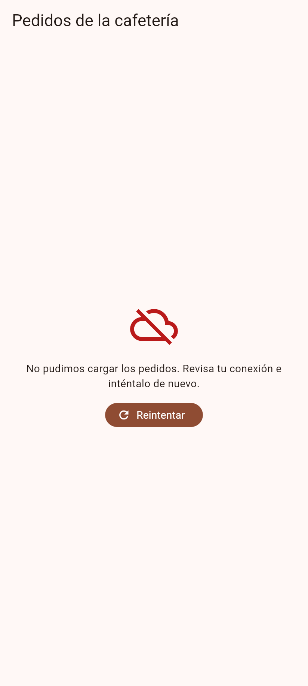

# Lista con tres estados (Nivelación T3)

Pantalla de Flutter que muestra una lista de pedidos de una cafetería con tres estados controlados
por la clase sellada `Resultado<T>`: **Cargando**, **Exito** (lista de tarjetas) y **Error** (mensaje
legible y botón **Reintentar**). Solo usa `StatefulWidget` y `setState`.

> La entidad `Pedido` y los datos de ejemplo (ficticios) vienen del caso de estudio del curso
> (gestor de cafetería). Si la entidad del proyecto real del equipo es distinta, hay que cambiar
> `lib/pedido.dart` y los datos de `lib/repositorio_falso.dart`.

## Estructura

```
lib/
  main.dart               MaterialApp (Material 3) que muestra la pantalla
  resultado.dart          sealed class Resultado<T>: Cargando, Exito(datos), Error(mensaje)
  pedido.dart             entidad Pedido y enums Bebida, Tamano, EstadoPedido
  repositorio_falso.dart  Future.delayed de 1.5 s; falla la 1a llamada y funciona la 2a
  pantalla_pedidos.dart   StatefulWidget con el switch exhaustivo de los tres estados
test/
  pantalla_pedidos_test.dart  widget tests: tres estados, reintento y mounted
  repositorio_falso_test.dart pruebas del repositorio falso
docs/
  ia-t3.md                declaración de uso de IA (Nivel 2)
  evidencia/              capturas de los estados
```

## Ejecutar y probar

```bash
flutter pub get
flutter run            # en un emulador o dispositivo; o: flutter run -d chrome
flutter analyze
flutter test
```

Al abrir la app se ve el indicador de carga; a los 1.5 s aparece el error (la primera llamada
falla a propósito) y, al pulsar **Reintentar**, vuelve a cargar y muestra la lista.

## Evidencia

| Cargando | Error con Reintentar | Cargando tras Reintentar | Lista |
| --- | --- | --- | --- |
|  |  |  |  |

## Uso de IA

Ver [docs/ia-t3.md](docs/ia-t3.md). Los bloques generados con IA están marcados con `// IA:`.
